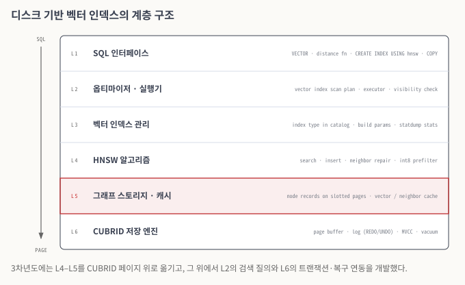

# 2026

이 문서는 2026년(3차년도) 개발 내용을 기술한다. 3차년도의 주제는 **디스크 기반 벡터 인덱스**다. 2025년에는 벡터 타입, 거리 함수와 연산자, 벡터 인덱스 생성 구문, 벡터 인덱스 스캔 실행 계획을 만들었고, 인덱스는 메모리에 두었다. 2026년에는 그 인덱스를 CUBRID의 페이지 위로 옮기고, 그 위에서 트랜잭션·복구와 벡터 검색 질의가 B-tree 인덱스와 같은 방식으로 동작하도록 개발했다.

3차년도의 개발 항목은 다음 세 가지다.

* **벡터 인덱싱 SW 포팅**: HNSW 그래프를 CUBRID 페이지에 저장하고, 페이지 크기, 동시성 제어(MVCC), 트랜잭션과 장애 복구를 고려하도록 확장한다.
* **벡터 인덱스 기반 검색 질의 수행 개발**: 옵티마이저가 벡터 인덱스 스캔 플랜을 만들고, 실행기가 그 플랜에 따라 디스크 기반 인덱스를 조회한다. 벡터 인덱스 처리에 대한 trace 정보와 성능 통계를 수집하고 출력한다.
* **검색 질의 검증을 위한 테스트 케이스 개발**: 다양한 벡터 검색 질의와, 정형 데이터 조건과 벡터 검색을 함께 쓰는 질의를 검증하는 테스트 케이스를 만든다.

사용자가 쓰는 문법과 파라미터의 변화는 매뉴얼의 [변경 이력](../../manual/revision.md)에 모아 두었다.

### 전체 구조

<figure><figcaption>
그림 1. 디스크 기반 벡터 인덱스의 계층 구조
</figcaption></figure>

*그림 설명 — 위에서 아래로, SQL 문장이 디스크 페이지에 닿기까지 거치는 계층이다. L1–L3은 2025년에 만든 SQL 인터페이스와 인덱스 관리 계층이고, L6은 B-tree와 힙이 이미 쓰고 있는 CUBRID 저장 엔진이다. 3차년도의 중심은 붉게 표시한 L5다. 메모리에 있던 HNSW 그래프를 L5에서 CUBRID 페이지의 레코드로 바꾸었고, 그 결과 L6의 페이지 버퍼, 로그, MVCC, vacuum을 벡터 인덱스도 함께 쓰게 되었다.*

벡터 인덱스는 다른 인덱스처럼 SQL 계층에서 생성되고 조회된다. 벡터 인덱스만 다루는 별도의 저장 장치나 별도 프로세스는 두지 않는다. 그래프를 이루는 노드와 간선은 CUBRID 페이지 안의 레코드이고, 그 페이지는 다른 데이터 페이지와 같은 버퍼 풀을 거쳐 읽고 쓴다. 따라서 인덱스를 고치는 작업은 같은 트랜잭션의 로그에 남고, 장애가 나면 같은 복구 절차로 되살아난다.

알고리즘 계층(L4)과 스토리지 계층(L5)은 분리했다. 알고리즘 계층은 "이 노드의 이웃을 달라", "이 노드의 벡터를 달라", "새 노드를 추가하라" 같은 요청만 스토리지 계층에 보내고, 그 요청이 메모리에서 처리되는지 페이지에서 처리되는지는 알지 못한다. 이렇게 나눈 이유는 HNSW 이외의 그래프 인덱스(예: DiskANN 계열)를 같은 스토리지 위에 추가할 수 있게 하려는 것이다.

### 문서 구성

| 문서 | 내용 |
| --- | --- |
| [디스크 기반 벡터 인덱스 구조](disk-vector-index.md) | 파일과 페이지, 노드 레코드, 페이지 크기 고려, 캐시, 병렬 적재 |
| [동시성 제어와 트랜잭션·복구](transaction-recovery.md) | 엔트리의 버전 관리, DELETE·UPDATE와 vacuum, 롤백, 로그와 복구, 병렬 입력·검색 |
| [벡터 인덱스 기반 검색 질의](vector-search-query.md) | 실행 계획, 실행기, 조건을 결합한 검색, trace와 성능 통계, 드라이버와 대량 적재 |
| [벤치마크 (CUBRID ann-benchmarks)](benchmark.md) | ann-benchmarks에 추가한 CUBRID 알고리즘, 측정 절차, 실행 방법 |
| [검증](verification.md) | 테스트 케이스 구성, 트랜잭션·복구·동시성 시나리오, 자동 회귀 테스트 |

### 코드와 이슈

3차년도 개발은 CUBRID 저장소의 벡터 기능 브랜치에서 진행했다.

* [cubvec/cubvec](https://github.com/CUBRID/cubrid/tree/cubvec/cubvec): 디스크 기반 인덱스의 기본 구조, 카탈로그 확장, 성능 통계, `CREATE INDEX … USING hnsw` 구문
* [cubvec/m1](https://github.com/CUBRID/cubrid/tree/cubvec/m1): 성능 개선, 드라이버 네이티브 벡터 전송, `COPY FROM STDIN`, 트랜잭션·복구와 동시성

개발 이슈와 각 이슈의 테스트 계획은 [CUBVEC 프로젝트](https://jira.cubrid.org/projects/CUBVEC/issues)에 공개되어 있다.
