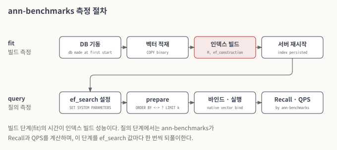

# 벤치마크 (CUBRID ann-benchmarks)

벡터 DB의 검색 성능과 인덱스 빌드 성능은 [ANN Benchmarks](https://ann-benchmarks.com/)로 측정한다. 과제의 성능 지표가 이 벤치마크와 그 평가 원칙을 기준으로 하기 때문이다. 3차년도에는 ann-benchmarks에 CUBRID 알고리즘을 추가하고, 같은 절차로 비교 대상(pgvector)도 측정할 수 있는 환경을 만들었다. 이 문서는 도구의 구성과 측정 절차를 기술하며, 측정 결과는 다루지 않는다.

### 저장소

CUBRID 알고리즘을 추가한 ann-benchmarks는 [cubrid/ann-benchmarks](https://github.com/cubrid/ann-benchmarks)에 있다. 3차년도 측정에 쓴 브랜치는 `cubvec/tta`이다. CUBRID 알고리즘은 `ann_benchmarks/algorithms/cubrid/` 아래에 있고, 다른 알고리즘과 같이 Docker 이미지 하나와 파라미터 설정 파일 하나로 이루어진다.

| 파일 | 역할 |
| --- | --- |
| `Dockerfile` | 지정한 CUBRID 소스(원격 저장소와 브랜치 또는 커밋)를 받아 빌드하고, CCI와 Python 드라이버를 함께 빌드한다 |
| `init-cubrid.sh` | 컨테이너가 처음 시작될 때 데이터베이스와 사용자를 만든다 |
| `module.py` | ann-benchmarks가 부르는 알고리즘 구현이다. 데이터 적재, 인덱스 생성, 질의 수행을 맡는다 |
| `config.yml` | 실행할 파라미터 조합을 정한다 |

### 측정 절차

ann-benchmarks는 알고리즘마다 두 단계를 측정한다. 인덱스 빌드(`fit`)와 질의(`query`)다. CUBRID 알고리즘은 각 단계에서 다음을 한다.

1. **데이터 적재.** 학습 데이터셋의 벡터를 `COPY … FROM STDIN WITH (FORMAT BINARY)`로 테이블에 넣는다. 벡터를 문자열로 바꾸지 않고 바이너리로 보낸다.
2. **인덱스 빌드.** 데이터가 들어간 테이블에 HNSW 인덱스를 만든다. 빌드 파라미터는 `M`과 `ef_construction`이다. 이 시간이 빌드 성능이다.
3. **질의 준비.** 질의 파라미터마다 `SET SYSTEM PARAMETERS 'hnsw_ef_search=…'`로 탐색 넓이를 정하고, 검색 질의를 한 번 prepare한다.
4. **질의 수행.** 테스트 데이터셋의 벡터를 하나씩 드라이버의 네이티브 벡터 타입으로 바인드해 실행한다. 결과와 정답을 비교한 Recall, 그리고 초당 질의 수(QPS)는 ann-benchmarks가 계산한다.

pgvector와 같은 절차로 맞추기 위해, 빌드 단계에는 서버 기동이 포함된다. 이때 데이터베이스 볼륨이 Docker 이미지의 하위 계층에 있으면, 서버가 볼륨을 처음 쓰기 모드로 열 때 파일 전체가 복사되어 기동이 수십 초 늦어진다. 이것은 엔진이 아니라 컨테이너 파일 시스템의 동작이다. 그래서 데이터베이스는 이미지를 만들 때가 아니라 컨테이너가 처음 시작될 때 만든다. pgvector도 데이터베이스 초기화를 측정 밖에서 한다.

측정 중에는 단계마다 `statdump`의 통계와 perf 프로파일을 함께 모을 수 있다. 통계 항목은 [벡터 인덱스 기반 검색 질의](vector-search-query.md)에 정리했다.

<figure><figcaption><p>그림 1. ann-benchmarks 측정 절차</p></figcaption></figure>

*그림 설명 — 위 줄이 빌드 단계, 아래 줄이 질의 단계다. 빌드 단계에서 붉게 표시한 인덱스 빌드가 빌드 성능을 좌우하고, 서버를 재시작한 뒤 질의 단계로 넘어간다. 질의 단계는 ef_search 값마다 되풀이된다.*

### 파라미터

`config.yml`의 기본 실행 그룹은 다음과 같다.

| 그룹 | 빌드 파라미터 | 질의 파라미터 (`hnsw_ef_search`) |
| --- | --- | --- |
| `M-16` | M = 16, ef\_construction = 200 | 10, 20, 40, 80, 120, 200, 400, 800 |
| `M-24` | M = 24, ef\_construction = 200 | 10, 20, 40, 80, 120, 200, 400, 800 |

더 큰 M(32, 36, 48)의 그룹도 설정 파일에 주석으로 들어 있다.

서버 설정은 이미지를 만들 때 `cubrid.conf`에 넣는다. 데이터 버퍼는 4GB(`data_buffer_size=4G`), 최대 클라이언트 수는 10(`max_clients=10`)이다. CUBRID는 SIMD(AVX2)를 쓰는 릴리스 프리셋(`release_avx2`)으로 빌드한다. 컨테이너 밖에서 운영하는 CUBRID를 측정할 때는 접속 정보(호스트, 포트, 데이터베이스 이름, 사용자)를 `ANN_BENCHMARKS_CUB_` 접두어의 환경 변수로 넘긴다.

### 실행 방법

ann-benchmarks 저장소에서 다음 순서로 실행한다. 평가 환경과 원칙은 ann-benchmarks 문서를 따른다.

```bash
git clone https://github.com/cubrid/ann-benchmarks.git
cd ann-benchmarks
git checkout cubvec/tta

# 비교 대상과 CUBRID 이미지를 만든다.
./scripts/install_pgvector.sh
./scripts/install_cubrid.sh --remote=https://github.com/CUBRID/cubrid.git --branch=cubvec/m1
# 특정 커밋을 측정하려면 --branch 대신 --commit=<commit_id>를 쓴다.

# 데이터셋 하나에 대해 측정한다.
./scripts/test.sh -a pgvector --dataset nytimes-256-angular --count 10
./scripts/test.sh -a cubrid --dataset nytimes-256-angular --count 10
```

`--count`는 질의마다 돌려받을 최근접 이웃의 수(k)다. 결과 그래프는 ann-benchmarks의 웹 페이지 생성 기능으로 만든다.

### 관련 이슈

[CUBVEC-155](https://jira.cubrid.org/browse/CUBVEC-155), [CUBVEC-156](https://jira.cubrid.org/browse/CUBVEC-156), [CUBVEC-174](https://jira.cubrid.org/browse/CUBVEC-174), [CUBVEC-179](https://jira.cubrid.org/browse/CUBVEC-179), [CUBVEC-182](https://jira.cubrid.org/browse/CUBVEC-182)
