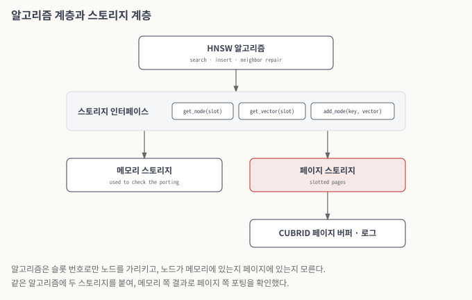
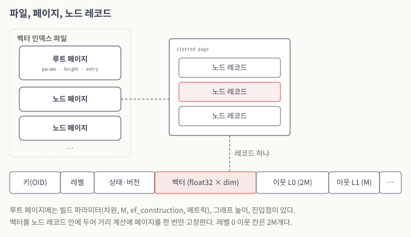

# 디스크 기반 벡터 인덱스 구조

이 문서는 HNSW 그래프를 CUBRID 페이지에 저장하는 방식을 기술한다. 2025년의 벡터 인덱스는 외부 라이브러리의 HNSW 구현을 메모리에 두었고, 서버를 다시 시작하면 인덱스를 다시 만들어야 했다. 2026년에는 같은 알고리즘을 CUBRID의 페이지 구조 위에서 동작하도록 다시 구현했다. 외부 라이브러리 의존성은 제거했다.

### HNSW를 고른 이유

벡터 인덱스 구조로는 IVF, HNSW, DiskANN 등이 제안되어 있지만, B-tree처럼 모든 경우에 나은 구조는 아직 없다. 그래서 특정 구조를 새로 제안하기보다, 어떤 그래프 구조든 CUBRID 스토리지 위에서 빠르게 동작하게 만드는 것을 목표로 했다. 첫 구현으로는 HNSW를 골랐다. HNSW는 빈 인덱스에 행을 하나씩 넣는 점진적 빌드에서도 검색 품질이 유지된다. DiskANN 계열은 한 번에 만든 정적 인덱스를 기본으로 하므로, 행이 계속 들어오는 테이블에서는 사용자가 인덱스를 다시 빌드해 품질을 맞춰야 한다.

### 계층의 분리

HNSW 구현은 두 계층으로 나뉜다.

* **알고리즘 계층**은 그래프 탐색, 노드 삽입, 이웃 선택, 이웃 목록 보수를 맡는다. 노드는 슬롯 식별자로만 가리키고, 노드의 내용이 어디에 있는지는 모른다.
* **스토리지 계층**은 슬롯 식별자로 노드와 벡터를 꺼내 주고, 새 노드를 저장하고, 페이지를 할당한다. 노드를 꺼낼 때는 페이지를 버퍼에 고정(fix)하고, 쓰기가 끝나면 해제(unfix)한다.

포팅 과정에서는 같은 알고리즘 계층에 두 가지 스토리지를 붙였다. 하나는 모든 데이터를 메모리에 두는 스토리지이고, 다른 하나는 페이지에 두는 스토리지다. 먼저 메모리 스토리지로 알고리즘 포팅이 맞는지 확인하고, 다음에 페이지 스토리지가 같은 결과를 내는지 확인했다.

<figure><figcaption>
그림 1. 알고리즘 계층과 스토리지 계층
</figcaption></figure>

*그림 설명 — 위에서 아래로 읽는다. 알고리즘은 가운데 회색 띠의 세 가지 요청만 쓴다. 그 아래에서 메모리 스토리지와 페이지 스토리지가 같은 요청을 구현하며, 붉게 표시한 페이지 스토리지만 CUBRID 페이지 버퍼와 로그를 거친다.*

### 파일, 페이지, 노드 레코드

벡터 인덱스를 만들면 벡터 인덱스 전용 파일이 하나 생긴다. 파일의 첫 페이지는 루트 페이지이고, 나머지 페이지에는 그래프 노드가 레코드로 들어간다. 인덱스를 삭제하면 파일도 함께 제거된다.

루트 페이지에는 다음이 들어 있다.

| 항목 | 내용 |
| --- | --- |
| 빌드 파라미터 | 차원, M, ef\_construction, 거리 메트릭 |
| 그래프 높이 | 현재 가장 높은 레벨 |
| 진입점 | 검색과 삽입을 시작하는 노드 |

그래프 노드 하나는 레코드 하나다. 레코드는 다음 순서로 구성된다.

| 부분 | 내용 |
| --- | --- |
| 키 | 힙에서 그 행의 위치(OID) |
| 레벨 | 이 노드가 올라가 있는 가장 높은 레벨 |
| 상태와 버전 정보 | 삭제 표시 여부, 이 엔트리를 만든 트랜잭션과 제거한 트랜잭션 |
| 벡터 | 차원 수만큼의 float32 값 |
| 이웃 목록 | 레벨 0부터 노드의 레벨까지, 레벨마다 이웃 수와 이웃 슬롯 목록 |

레벨마다 이웃 목록의 칸 수는 M개로 고정된다. 가장 아래 레벨(레벨 0)만 2M개다. 레벨 0은 모든 노드가 들어가는 층이어서, 데이터 분포에 따라 그래프가 끊어지기 쉽다. 이웃 칸을 두 배로 두면 끊어짐이 줄어든다.

처음에는 노드 레코드와 벡터를 서로 다른 페이지에 저장했다. 그러면 거리를 한 번 계산할 때마다 노드 페이지와 벡터 페이지를 따로 고정해야 했다. 지금은 벡터를 노드 레코드 안에 함께 둔다. 벡터는 64바이트 경계에 맞춰 두어, SIMD 거리 연산이 정렬된 적재(aligned load)를 쓰도록 했다.

<figure><figcaption>
그림 2. 파일, 페이지, 노드 레코드
</figcaption></figure>

*그림 설명 — 왼쪽은 인덱스 파일의 페이지 구성, 가운데는 노드 페이지 하나, 아래 띠는 노드 레코드 하나의 필드 순서다. 붉게 표시한 벡터가 레코드 안에 있으므로, 이웃과의 거리를 계산할 때 다른 페이지를 고정하지 않는다.*

### 페이지 크기 고려

CUBRID 데이터베이스는 생성할 때 페이지 크기(4K, 8K, 16K)를 정한다. 노드 레코드는 그 페이지의 slotted page 레코드로 들어가므로, 레코드 하나는 페이지 하나를 넘을 수 없다. 노드 레코드의 크기는 차원과 M과 레벨로 정해진다. 새 노드를 넣을 때는 마지막으로 쓰던 페이지의 여유 공간을 보고, 모자라면 새 페이지를 할당한다. 어떤 페이지에도 들어가지 않는 크기의 엔트리는 페이지를 할당하기 전에 삽입 단계에서 오류로 처리한다. 이 검사가 없으면 들어갈 수 없는 엔트리를 위해 볼륨이 찰 때까지 페이지를 할당하게 된다.

새 페이지는 사용자 트랜잭션과 분리된 시스템 연산 안에서 할당한다. 페이지 할당을 사용자 트랜잭션의 undo 범위에 두면, 그 트랜잭션이 롤백될 때 그래프가 아직 가리키고 있는 페이지가 해제될 수 있다. B-tree와 힙도 페이지 할당은 되돌리지 않고, 페이지 안의 내용만 논리적으로 되돌린다. 벡터 인덱스도 같은 규칙을 따른다.

### 카탈로그와 인덱스 타입

2025년까지 CUBRID의 카탈로그는 모든 인덱스를 B-tree로 간주했다. 벡터 인덱스를 추가하면서 클래스의 표현 정보(Root Class), 통계 정보를 담는 System Catalog, 카탈로그 클래스(`_db_index`)에 인덱스 타입을 함께 기록하도록 확장했다. 그 결과 B-tree 통계에는 B-tree 인덱스만 들어가고, 옵티마이저는 인덱스 타입을 보고 B-tree와 벡터 인덱스를 구분한다. 기존 B-tree 사용자가 보는 SQL, 통계, 카탈로그 조회 결과는 바뀌지 않는다.

서버를 정상 종료한 뒤 다시 시작하면, 벡터 인덱스를 처음 쓰는 시점에 루트 페이지 헤더에서 빌드 파라미터를 읽어 인덱스 객체를 다시 만든다. 이때 인덱스를 새로 생성하는 경로를 타지 않으므로 루트 페이지의 그래프 정보는 그대로 유지된다.

### 캐시

HNSW 검색은 노드를 하나 방문할 때마다 그 노드의 이웃 목록을 읽고, 이웃마다 거리를 계산한다. 노드가 페이지에 있으므로, 방문 한 번은 페이지 고정과 해제 한 번이다. 같은 노드는 한 번의 탐색에서도 여러 번 방문되고, 인덱스 빌드 중에는 더 자주 방문된다. 그래서 스토리지 계층에 두 가지 캐시를 두었다.

* **벡터 캐시**: 행의 키로 벡터를 찾는다. 거리를 계산할 때 이미 캐시에 있는 벡터는 페이지를 고정하지 않고 쓴다.
* **이웃 캐시**: 노드와 레벨로 이웃 슬롯 목록을 찾는다. 이웃을 순회할 때 캐시에 있으면 페이지를 고정하지 않는다.

캐시는 페이지 내용과 어긋나면 안 된다. 삽입이 이웃 목록에 간선을 더하면 캐시도 같이 고친다. 또 검색이 페이지를 놓은 뒤에 캐시를 채우다가, 그 사이에 다른 삽입이 더한 간선을 덮어쓰는 일이 없도록 한다. 캐시의 동시 접근 보호는 [동시성 제어와 트랜잭션·복구](transaction-recovery.md)에서 다룬다.

### 거리 계산

거리 함수는 외부 라이브러리 대신 자체 구현으로 바꾸었고, SIMD(AVX2) 명령으로 계산한다. 앞에서 말한 64바이트 정렬도 이 연산을 위한 것이다. 인덱스 빌드에서는 시간의 대부분이 거리 계산에 쓰이므로, 정밀한(float32) 계산 전에 저정밀도(int8 양자화) 거리로 후보를 먼저 거르는 방식도 시험했다.

### 병렬 적재

테이블에 데이터가 이미 있는 상태에서 벡터 인덱스를 만들면, 서버는 힙에서 행을 읽어 인덱스에 한꺼번에 넣는다. 이 작업은 CUBRID의 worker pool로 병렬화한다. 각 작업자는 자기 스레드 문맥을 가지고 페이지 버퍼에 접근한다. `loaddb`의 병렬 적재(`-C`)로 여러 트랜잭션이 동시에 벡터를 넣는 경우도 지원한다.

### 관련 이슈

[CUBVEC-130](https://jira.cubrid.org/browse/CUBVEC-130), [CUBVEC-138](https://jira.cubrid.org/browse/CUBVEC-138), [CUBVEC-140](https://jira.cubrid.org/browse/CUBVEC-140), [CUBVEC-142](https://jira.cubrid.org/browse/CUBVEC-142), [CUBVEC-147](https://jira.cubrid.org/browse/CUBVEC-147), [CUBVEC-151](https://jira.cubrid.org/browse/CUBVEC-151), [CUBVEC-152](https://jira.cubrid.org/browse/CUBVEC-152), [CUBVEC-154](https://jira.cubrid.org/browse/CUBVEC-154), [CUBVEC-160](https://jira.cubrid.org/browse/CUBVEC-160), [CUBVEC-167](https://jira.cubrid.org/browse/CUBVEC-167), [CUBVEC-171](https://jira.cubrid.org/browse/CUBVEC-171), [CUBVEC-177](https://jira.cubrid.org/browse/CUBVEC-177), [CUBVEC-188](https://jira.cubrid.org/browse/CUBVEC-188)
