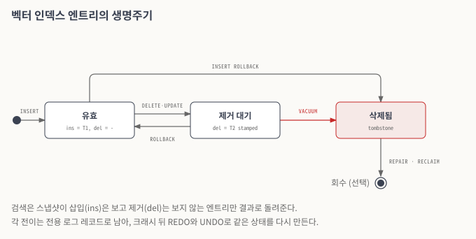
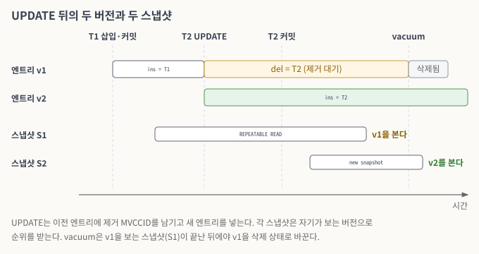
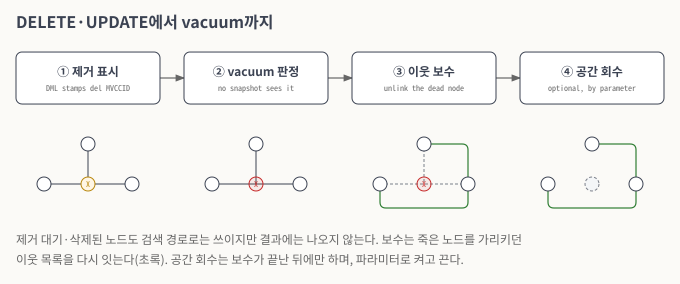
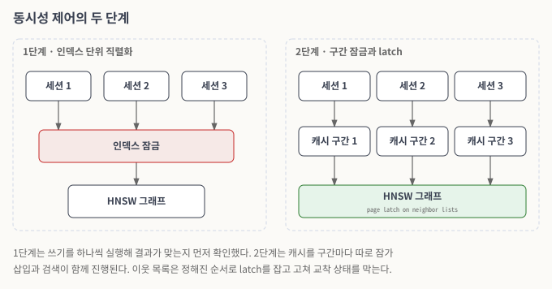

# 동시성 제어와 트랜잭션·복구

이 문서는 디스크 기반 벡터 인덱스가 트랜잭션 안에서 어떻게 동작하는지 기술한다. 목표는 벡터 인덱스도 B-tree 인덱스와 같은 약속을 지키는 것이다. 커밋한 변경은 검색 결과에 나오고, 롤백한 변경은 나오지 않는다. 장애가 나도 커밋한 변경만 남는다. 여러 세션이 같은 인덱스를 동시에 쓰고 읽어도 서버가 멈추거나 잘못된 결과를 내지 않는다.

### 엔트리의 생명주기

<figure><figcaption>
그림 1. 벡터 인덱스 엔트리의 생명주기
</figcaption></figure>

*그림 설명 — 인덱스 엔트리 하나가 거치는 상태다. 왼쪽부터 읽는다. INSERT로 만들어진 엔트리는 "유효" 상태이고, DELETE나 UPDATE가 제거한 트랜잭션을 표시하면 "제거 대기" 상태가 된다. 붉은 화살표가 핵심이다. 제거 대기 엔트리는 그 버전을 보는 스냅샷이 모두 사라진 뒤에야 vacuum이 "삭제됨"으로 바꾼다. 위쪽의 INSERT ROLLBACK과 아래쪽의 ROLLBACK은 트랜잭션이 자기가 한 일만 되돌리는 경로다.*

그래프 노드는 물리적으로 지우기 어렵다. 노드 하나를 지우면 그 노드를 이웃으로 가리키던 다른 노드들의 이웃 목록을 모두 다시 이어야 하고, 그 작업은 비용이 크며 동시에 진행되는 검색과 충돌한다. 그래서 행이 삭제되어도 노드는 곧바로 지우지 않고, 상태로 표시한 뒤 탐색 경로로는 계속 쓴다. 다만 최종 검색 결과에서는 제외한다.

### 버전 정보와 스냅샷

엔트리마다 그 엔트리를 만든 트랜잭션(삽입 MVCCID)과 제거한 트랜잭션(제거 MVCCID)을 기록한다. B-tree 엔트리가 버전 정보를 지니는 방식과 같다. 검색은 결과를 돌려주기 전에, 질의의 스냅샷이 그 엔트리의 삽입은 보고 제거는 보지 않는지 확인한다. 이 조건을 만족하는 엔트리만 결과가 된다. 결과 행은 다시 힙에서 그 버전이 보이는지 확인한 뒤 반환한다.

이 방식이 필요한 경우는 UPDATE다. CUBRID는 UPDATE를 "이전 값 제거 + 새 값 삽입"으로 실행하므로, vacuum이 오기 전까지 한 행이 인덱스에 엔트리 두 개(이전 벡터, 새 벡터)를 가진다. 버전 정보가 없으면 검색은 둘 중 질의 벡터에 더 가까운 쪽으로 행의 순위를 매긴다. 그러면 REPEATABLE READ 트랜잭션처럼 이전 스냅샷을 유지하는 질의가 아직 보지 못한 새 벡터로 순위를 받는다. 반대로 새 스냅샷의 질의가 이미 지난 벡터로 순위를 받기도 한다. 버전 정보가 있으면 각 질의는 자기 스냅샷이 보는 벡터로만 순위를 받는다.

벡터가 아닌 컬럼만 바꾸는 UPDATE는 인덱스를 건드리지 않는다.

<figure><figcaption>
그림 2. UPDATE 뒤의 두 버전과 두 스냅샷
</figcaption></figure>

*그림 설명 — 위의 점선이 시간 순서의 사건이다. 엔트리 v1은 T1이 넣었고 T2의 UPDATE부터 제거 대기(노랑)가 되며, v2는 그때 생긴다(초록). 아래 두 스냅샷 가운데 T2 커밋 전에 시작한 S1은 끝까지 v1을, 커밋 뒤의 S2는 v2를 본다. vacuum은 S1이 끝난 뒤에야 v1을 삭제 상태로 바꾼다.*

### DELETE, UPDATE와 vacuum

DELETE와 UPDATE는 문장을 실행할 때 제거되는 엔트리에 자기 MVCCID를 표시하고, vacuum이 처리할 작업 항목을 남긴다. 엔트리는 아직 지워지지 않는다. 그 버전을 볼 수 있는 스냅샷이 모두 사라지면 vacuum이 작업 항목에 이르러 엔트리를 삭제 상태로 바꾼다. 같은 행의 다른 버전 엔트리는 건드리지 않고, 표시가 일치하는 엔트리만 바꾼다.

삭제 상태가 된 노드를 가리키던 이웃 목록은 vacuum에서 보수한다. 죽은 노드를 빼고, 필요하면 다른 이웃으로 채운다. 새 노드를 연결할 때도 죽은 노드는 이웃으로 고르지 않는다. 노드가 차지하던 공간을 회수하는 일은 파라미터로 켜고 끈다. 회수는 이웃 목록 보수가 끝난 뒤에만 한다. 먼저 회수하면 아직 그 노드를 가리키는 목록이 빈 자리를 가리키게 되기 때문이다.

<figure><figcaption>
그림 3. DELETE·UPDATE에서 vacuum까지
</figcaption></figure>

*그림 설명 — 위 줄은 단계, 아래 줄은 각 단계에서 노드 X 주변 그래프의 모양이다. ①에서 X에 제거 MVCCID가 표시되고(노랑), ②에서 삭제 상태가 된다(빨강). ③에서는 X를 가리키던 간선 대신 이웃끼리 다시 이어지고(초록), ④에서 X의 공간이 회수된다.*

### 롤백

롤백은 자기 트랜잭션이 한 일만 되돌린다.

* **INSERT 롤백**: 삽입한 노드를 삭제 상태로 표시한다. 그래프에 이미 연결된 간선은 vacuum이 삭제된 노드에 하듯 보수하고 회수한다.
* **DELETE 롤백**: 제거 표시를 지워 엔트리를 유효 상태로 되돌린다. 같은 행에 삭제된 엔트리가 여러 개 있을 수 있으므로, 되살릴 엔트리는 로그에 함께 남긴 벡터로 구분한다.
* **UPDATE 롤백**: 새 엔트리는 삭제 상태로, 이전 엔트리는 유효 상태로 되돌린다. UPDATE를 제거와 삽입의 두 연산으로 기록하므로, 각 연산의 되돌리기가 그대로 적용된다.

### 로그와 복구

벡터 인덱스 전용 로그 레코드 타입을 추가했다. 엔트리 삽입, 삭제, 되살리기(revive)의 세 가지다. 각 레코드는 페이지의 바이트가 아니라 "어느 행의 어떤 벡터를 넣었다/지웠다"는 논리 연산을 기록한다. 그래프 구조는 삽입 순서와 탐색 결과에 따라 달라지므로, 같은 연산을 다시 적용하는 논리 로그가 맞다.

* **REDO**: 서버가 비정상 종료한 뒤 다시 시작하면, 복구 과정이 커밋된 트랜잭션의 삽입, 삭제, 갱신을 인덱스에 다시 적용한다. 벡터 인덱스는 캐시를 쓰므로 커밋된 변경이 아직 디스크 페이지에 반영되지 않았을 수 있는데, REDO가 그 차이를 메운다.
* **UNDO**: 커밋되지 않은 트랜잭션의 변경은 복구 과정에서 되돌린다. 롤백 중에 장애가 나도 되돌리기를 다시 재현할 수 있도록, DELETE의 되돌리기는 보상 로그를 남긴다.

진행 중인 트랜잭션과 완료된 트랜잭션이 섞인 상태에서 장애가 나도, 복구가 끝나면 완료된 트랜잭션의 변경만 인덱스 검색 결과에 남는다. 이때 힙의 행 상태와 인덱스 검색 결과가 일치한다. 인덱스를 만들고 지우는 DDL 자체의 되돌리기는 이번 범위에서 다루지 않았다.

### 동시성 제어

벡터 인덱스는 인덱스마다 그래프 객체 하나를 서버 전체가 공유한다. 두 세션이 같은 인덱스에 삽입하면 두 스레드가 한 그래프를 동시에 고친다. 검색도 캐시가 비어 있으면 캐시에 쓰므로, 검색과 삽입이 같은 자료 구조를 함께 고칠 수 있다. 동시성 제어는 두 단계로 진행했다.

1. **인덱스 단위 직렬화.** 먼저 그래프와 캐시를 인덱스 하나에 대한 잠금으로 보호했다. 동시에 여러 트랜잭션이 같은 인덱스에 INSERT, UPDATE, DELETE를 해도 결과가 맞다는 것을 이 단계에서 확인했다. 대신 한 인덱스 안의 쓰기는 하나씩 실행된다.
2. **구간별 잠금과 페이지 latch.** 다음으로 보호 범위를 나누었다. 캐시는 키 구간마다 읽기·쓰기 잠금을 따로 두어, 서로 다른 구간을 읽고 쓰는 스레드가 서로 기다리지 않게 했다. 이웃 목록을 고치는 일은 그 노드가 있는 페이지의 latch를 잡고 한다. 이웃을 보수할 때는 노드 표시를 끝낸 뒤 latch를 놓고 진행하는 등, latch를 잡는 순서를 정해 교착 상태를 막았다. 이로써 여러 세션의 동시 삽입, 여러 작업자를 쓰는 인덱스 적재, 삽입 중인 인덱스에 대한 검색이 함께 진행된다.

서버를 다시 시작한 뒤 인덱스를 처음 쓰는 순간에는 여러 세션이 동시에 같은 인덱스를 적재하려 할 수 있다. 적재는 한 번만 일어나고, 나머지 세션은 적재된 객체를 함께 쓴다.

복제(HA)에서의 동작은 4차년도 개발 범위다.

<figure><figcaption>
그림 4. 동시성 제어의 두 단계
</figcaption></figure>

*그림 설명 — 왼쪽이 1단계, 오른쪽이 2단계다. 1단계에서는 모든 세션이 붉게 표시한 잠금 하나를 거쳐 차례로 그래프를 고친다. 2단계에서는 세션마다 서로 다른 캐시 구간을 잡고, 그래프의 이웃 목록은 페이지 latch로 보호하므로 세션들이 함께 진행된다.*

### 관련 이슈

[CUBVEC-180](https://jira.cubrid.org/browse/CUBVEC-180), [CUBVEC-181](https://jira.cubrid.org/browse/CUBVEC-181), [CUBVEC-183](https://jira.cubrid.org/browse/CUBVEC-183), [CUBVEC-185](https://jira.cubrid.org/browse/CUBVEC-185), [CUBVEC-186](https://jira.cubrid.org/browse/CUBVEC-186), [CUBVEC-188](https://jira.cubrid.org/browse/CUBVEC-188)
