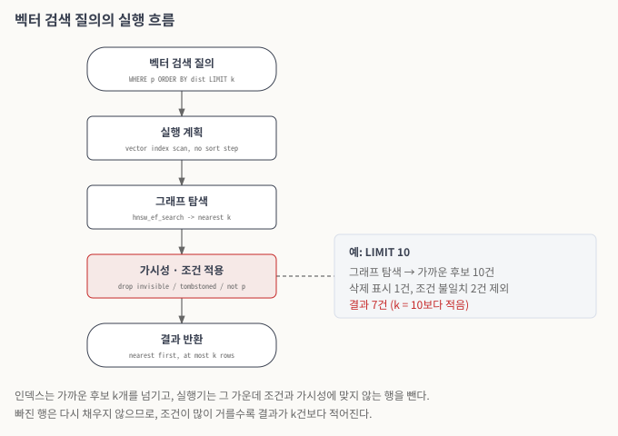

# 벡터 인덱스 기반 검색 질의

이 문서는 디스크 기반 벡터 인덱스를 이용해 검색 질의를 수행하는 과정을 기술한다. 옵티마이저가 벡터 인덱스 스캔 플랜을 만들고, 실행기가 그 플랜에 따라 인덱스를 조회하며, 그 과정의 trace 정보와 성능 통계를 수집한다. 사용자 문법은 매뉴얼의 [벡터 인덱스 지원](../../manual/vector-index.md)과 [DML](../../manual/dml.md)에 있다.

### 실행 계획

벡터 검색 질의는 다음 모양이다.

```sql
SELECT id
FROM items
WHERE category = 'news'
ORDER BY l2_distance (embedding, '[0.12, 0.33, ...]')
LIMIT 10;
```

옵티마이저는 `ORDER BY`의 거리 함수(또는 거리 연산자)가 벡터 인덱스의 컬럼과 메트릭에 맞고 `LIMIT`이 있으면 벡터 인덱스 스캔 플랜을 만든다. 벡터 인덱스는 결과를 거리 순서로 돌려주므로, 이 플랜에는 `ORDER BY`를 위한 정렬 단계를 붙이지 않는다. 플랜을 고를 때는 카탈로그에 기록된 인덱스 타입을 보고 B-tree 통계와 벡터 인덱스를 구분한다.

### 실행기

실행기는 플랜에 따라 디스크 기반 벡터 인덱스를 조회한다. 인덱스는 그래프를 탐색해 질의 벡터에 가까운 후보 k개를 거리 순서로 넘기고, 실행기는 각 후보에 세 가지를 확인한다. 삭제 표시된 엔트리인지, 질의의 스냅샷에서 보이는 행인지, `WHERE` 조건을 만족하는지다. 세 가지를 모두 통과한 행만 결과가 된다.

<figure><figcaption><p>그림 3. 벡터 검색 질의의 실행 흐름</p></figcaption></figure>

*그림 설명 — 위에서 아래로 읽는다. 질의는 정렬 단계가 없는 벡터 인덱스 스캔 플랜으로 실행되고, 그래프 탐색이 가까운 후보 k개를 넘긴다. 붉게 표시한 단계에서 보이지 않는 행, 삭제 표시된 엔트리, 조건에 맞지 않는 행이 빠진다. 오른쪽 예처럼 빠진 행을 다시 채우지 않으므로, `LIMIT 10`이어도 결과는 7건일 수 있다.*

이 동작에서 사용자가 알아야 할 점은 다음과 같다.

* 결과는 `LIMIT k`의 k건 이하다. 조건이 후보를 많이 거르거나, 삭제·갱신된 행이 많이 남아 있으면 k건보다 적어진다.
* 결과 행은 가까운 순서로 나온다.

그래프 탐색의 넓이는 시스템 파라미터 `hnsw_ef_search`로 정한다. 값이 클수록 한 번의 탐색이 더 많은 후보를 보므로 Recall이 오르고 질의 시간이 늘어난다. 이 파라미터는 세션마다 바꿀 수 있다.

### 드라이버와 대량 적재

질의 벡터를 문자열로 보내면, 클라이언트는 float 배열을 `'[0.12, 0.33, ...]'` 문자열로 바꾸고, 브로커(CAS)는 그 문자열을 다시 파싱해 벡터 값으로 바꾼다. 측정해 보니 이 변환과 파싱이 질의마다 반복되었다. 그래서 CCI와 Python 드라이버에 벡터 타입을 추가해, 드라이버와 CAS 사이에서 차원과 float 배열을 그대로 주고받게 했다.

대량 적재에는 `COPY … FROM STDIN WITH (FORMAT BINARY)` 구문을 추가했다. 클라이언트가 행을 바이너리 형식으로 보내면 서버가 바로 힙에 넣는다. 지원 타입은 INT, BIGINT, FLOAT, DOUBLE, VARCHAR, VECTOR이고, 현재는 Python 드라이버에서 쓸 수 있다.

### trace 정보와 성능 통계

`;trace on`을 켜고 질의를 실행하면, 벡터 인덱스 스캔이 별도 항목으로 나온다. 디스크 기반 인덱스로 바뀐 뒤에는 그 항목의 fetch와 ioread가 실제 인덱스 페이지 접근을 보여 준다. 출력 형식은 다음과 같다(값은 예시다).

```
Trace Statistics:
  SELECT (time: 9, fetch: 1, fetch_time: 0, ioread: 0)
    SCAN (vector index: dba.items.embedding), (noscan time: 1, fetch: 1, ioread: 0)
```

trace는 질의 하나의 합계만 보여 준다. 그래프 안에서 어디에 비용이 드는지 보려고 `statdump`에 HNSW 통계를 추가했다. 통계는 다음 묶음으로 나뉜다. 통계 이름은 매뉴얼의 [벡터 인덱스 지원](../../manual/vector-index.md)에 있다.

| 묶음 | 보여 주는 것 |
| --- | --- |
| 탐색 | 방문한 노드 수, 거리 계산 횟수, 이웃 순회 횟수 |
| 삽입 | 새 노드의 이웃을 고를 때와 기존 이웃 목록을 고칠 때의 거리 계산 횟수, 진입점 변경 횟수 |
| 후보 큐 | 후보 큐에 넣고 빼고 버린 횟수 |
| 스토리지 | 페이지 접근 횟수, 벡터 접근 횟수, 벡터 캐시와 이웃 캐시의 적중·실패 횟수 |
| 레벨 0 | 위 항목 가운데 가장 아래 레벨에서만 센 값 |

HNSW 탐색 비용은 대부분 레벨 0에서 생기므로, 레벨 0 값을 따로 둔다. 레벨마다 노드 수와 평균 이웃 수를 출력하는 그래프 프로파일도 있다. 이 통계로 3차년도에 다음을 확인했다.

* 그래프 기반 인덱스에서는 노드 방문 한 번이 페이지 접근 한 번과 이어진다. 그래서 캐시와 벡터 압축이 성능을 좌우한다. 벡터 캐시를 적용하자 nytimes-256 데이터의 인덱스 빌드에서 데이터 페이지 접근이 약 267억 회에서 7,085만 회로 줄었다.
* 인덱스 탐색이 끝난 뒤 결과 행을 힙에서 읽을 때, 레코드 안의 벡터 크기(float32 기준 256차원 약 1KB, 1536차원 약 6KB)만큼 힙 페이지 I/O가 늘어난다.
### 관련 이슈

[CUBVEC-128](https://jira.cubrid.org/browse/CUBVEC-128), [CUBVEC-162](https://jira.cubrid.org/browse/CUBVEC-162), [CUBVEC-172](https://jira.cubrid.org/browse/CUBVEC-172), [CUBVEC-174](https://jira.cubrid.org/browse/CUBVEC-174), [CUBVEC-176](https://jira.cubrid.org/browse/CUBVEC-176), [CUBVEC-86](https://jira.cubrid.org/browse/CUBVEC-86), [CUBVEC-137](https://jira.cubrid.org/browse/CUBVEC-137)
