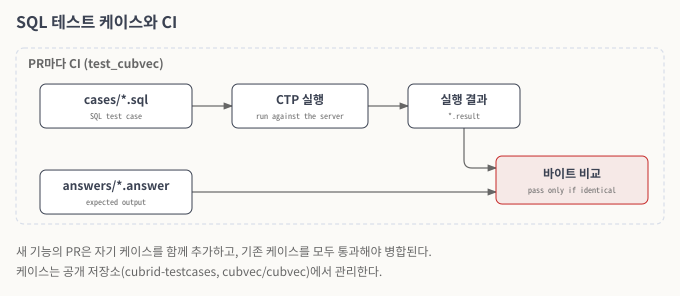
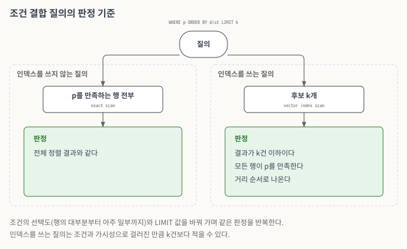
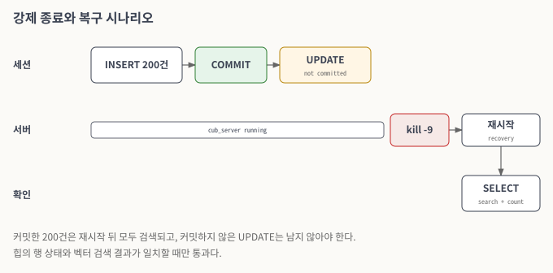
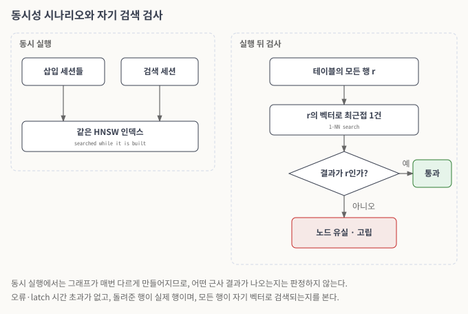

# 검증

이 문서는 3차년도 기능을 검증한 방법을 기술한다. 검증은 세 겹이다. 한 세션으로 결과를 정답과 비교하는 SQL 테스트 케이스, 여러 세션과 서버 재시작이 필요한 시나리오 테스트, 그리고 모든 PR에서 도는 자동 회귀 테스트다. 테스트 케이스는 공개 저장소에서 관리하고, 각 기능의 테스트 계획과 검증 시나리오는 해당 [CUBVEC 이슈](https://jira.cubrid.org/projects/CUBVEC/issues)에 공개되어 있다.

### SQL 테스트 케이스

SQL 테스트 케이스는 CUBRID 테스트 플랫폼(CTP)의 형식을 따른다. 케이스 파일(`cases/*.sql`) 옆에 정답 파일(`answers/*.answer`)이 있고, 실행 결과가 정답과 바이트 단위로 같아야 통과한다. 케이스는 [cubrid-testcases의 cubvec/cubvec 브랜치](https://github.com/CUBRID/cubrid-testcases/tree/cubvec/cubvec)의 `sql/_36_cubvec` 아래에 있다.

| 묶음 | 검증하는 것 |
| --- | --- |
| `_01_vector_data_validation` | 벡터 컬럼을 가진 테이블 생성, 컬럼 정보 조회, 벡터 값의 입력과 조회 |
| `_02_vector_distance` | 거리 함수(`l2_distance`, `cosine_distance`, `inner_product`, `l1_distance`, `vector_distance`)의 상수·컬럼·고차원 입력, 인덱스가 있을 때의 결과 |
| `_03_create_vector_index` | 벡터 인덱스 생성 구문, 재생성과 중복 생성, 빈 테이블과 데이터가 있는 테이블, 빌드 파라미터, 잘못된 메트릭의 오류 |
| `_04_select_vector_distance` | 인덱스를 쓰는 벡터 검색, `hnsw_ef_search` 변경, 영벡터와 코사인 거리, 세션 변수를 쓰는 질의의 실행 계획 |
| `_05_vector_distance_ops` | 거리 연산자와, 연산자·함수의 결과 일치, 인덱스가 있을 때와 없을 때의 결과 비교 |

<figure><figcaption>
그림 1. SQL 테스트 케이스와 CI
</figcaption></figure>

*그림 설명 — 점선 안 전체가 PR마다 CI에서 돈다. 케이스 SQL을 서버에서 실행한 결과와 아래의 정답 파일을 붉게 표시한 바이트 비교에 함께 넣고, 두 내용이 바이트까지 같을 때만 통과로 판정한다.*

### 정형 조건과 벡터 검색을 함께 쓰는 질의

`WHERE` 조건과 `ORDER BY 거리 LIMIT k`를 함께 쓰는 질의는 조건의 선택도를 바꿔 가며 검증한다. 조건이 행의 대부분을 남기는 경우부터 아주 일부만 남기는 경우까지, 그리고 `LIMIT` 값을 바꾸는 경우를 함께 본다. 판정 기준은 다음과 같다.

* 인덱스를 쓰지 않는 질의(정확 탐색)의 결과는 조건을 만족하는 행을 전부 정렬한 결과와 같아야 한다.
* 인덱스를 쓰는 질의의 결과는 k건 이하이고, 모든 행이 조건을 만족하며, 거리 순서여야 한다. 조건과 가시성으로 걸러진 만큼 k건보다 적을 수 있다.

<figure><figcaption>
그림 2. 조건 결합 질의의 판정 기준
</figcaption></figure>

*그림 설명 — 같은 질의를 인덱스를 쓰지 않을 때(왼쪽)와 쓸 때(오른쪽)로 나눠 실행하고, 각각 초록 상자의 기준으로 판정한다.*

### 트랜잭션·복구 시나리오

트랜잭션과 복구는 서버 강제 종료(`kill -9`)와 재시작, 여러 `csql` 세션의 동시 실행으로 검증한다. 검색 결과와 힙의 행 상태가 일치하는지를 매 단계에서 확인한다.

| 영역 | 시나리오 | 기대 결과 |
| --- | --- | --- |
| 삽입 복구 | 커밋한 단건·다건(200건) 삽입 뒤 강제 종료 | 재시작 후 모든 행이 검색된다 |
| 삽입 복구 | 정상 재시작을 사이에 둔 삽입 뒤 강제 종료 | 두 묶음의 삽입이 모두 남는다 |
| UPDATE·DELETE | 단건·다건 갱신과 삭제, 200건 중 100건 삭제와 50건 갱신 | 새 벡터로 검색되고, 이전 벡터와 삭제된 행은 나오지 않는다 |
| UPDATE·DELETE | 벡터가 아닌 컬럼만 갱신 | 검색 순위가 바뀌지 않는다 |
| 롤백 | INSERT, DELETE, UPDATE 각각의 롤백 | 롤백 전 상태로 검색된다 |
| 복구 | 진행 중인 트랜잭션과 완료된 트랜잭션이 섞인 상태에서 강제 종료 | 완료된 트랜잭션의 변경만 남는다 |
| 재시작 | 정상 종료 후 첫 번째와 두 번째 재시작 | 같은 검색이 같은 결과를 낸다 |

<figure><figcaption>
그림 3. 강제 종료와 복구 시나리오
</figcaption></figure>

*그림 설명 — 왼쪽에서 오른쪽이 시간 순서다. 세션이 200건을 넣고 커밋한 뒤, 다른 변경을 커밋하지 않은 채로 서버를 강제 종료한다(빨강). 재시작 복구 뒤 아래 줄의 SELECT로 커밋한 행만 남았는지 확인한다.*

### 동시성 시나리오

동시성은 여러 세션을 동시에 실행해 검증한다. 같은 인덱스에 동시에 삽입하는 경우, 삽입 중인 인덱스를 다른 세션이 검색하는 경우, 커밋과 롤백이 섞이는 경우를 본다.

동시 실행에서는 그래프가 매번 다르게 만들어지므로, 어떤 근사 결과가 나오는지는 판정 기준이 될 수 없다. 대신 실행마다 달라질 수 없는 것을 확인한다.

* 어떤 세션도 오류를 내지 않고, 페이지 latch 대기가 시간 초과되지 않는다(교착 상태가 없다).
* 모든 검색이 무언가를 찾고, 돌려준 행은 실제로 테이블에 있는 행이다.
* 실행이 끝난 뒤 모든 행이 자기 벡터로 검색된다. 인덱스에 있는 벡터의 최근접 이웃은 그 벡터 자신이어야 한다. 그래프가 노드를 잃었거나 어디서도 닿지 않는 부분에 연결했다면 이 검사에서 드러난다.

같은 방식으로 데이터가 있는 테이블에 인덱스를 만드는 병렬 적재도 검증한다. 같은 행으로 작업자 1개와 8개의 경우를 각각 만들어 두 인덱스가 모두 이 검사를 통과하는지 본다.

<figure><figcaption>
그림 4. 동시성 시나리오와 자기 검색 검사
</figcaption></figure>

*그림 설명 — 왼쪽은 동시 실행, 오른쪽은 실행 뒤 검사다. 삽입과 검색이 같은 인덱스에서 함께 돈 뒤, 모든 행을 자기 벡터로 검색해 그 행 자신이 나오면 통과(초록)다. 아니면 그래프가 노드를 잃었거나 어디서도 닿지 않는 부분이 생긴 것이다(빨강).*

### 자동 회귀 테스트

GitHub PR마다 CI가 빌드와 벡터 테스트 묶음(`test_cubvec`)을 실행한다. 새 기능의 PR은 자기 테스트 케이스를 함께 추가하고, 기존 테스트 케이스를 모두 통과해야 병합된다.

### 관련 이슈

[CUBVEC-59](https://jira.cubrid.org/browse/CUBVEC-59), [CUBVEC-80](https://jira.cubrid.org/browse/CUBVEC-80), [CUBVEC-136](https://jira.cubrid.org/browse/CUBVEC-136), [CUBVEC-183](https://jira.cubrid.org/browse/CUBVEC-183), [CUBVEC-185](https://jira.cubrid.org/browse/CUBVEC-185), [CUBVEC-186](https://jira.cubrid.org/browse/CUBVEC-186), [CUBVEC-188](https://jira.cubrid.org/browse/CUBVEC-188), [CUBVEC-190](https://jira.cubrid.org/browse/CUBVEC-190)
